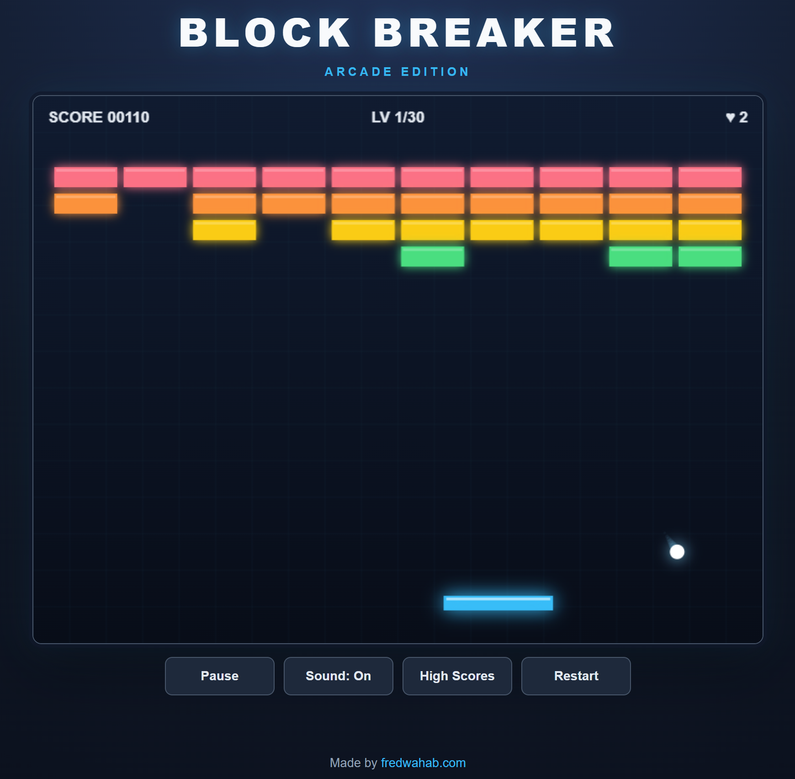

# Block Breaker

A modern, browser-based brick-breaker arcade game built with vanilla JavaScript, HTML5 Canvas, and Vite.

Control the paddle, keep the ball in play, and destroy increasingly challenging brick formations across **30 handcrafted levels**. Special bricks, power-ups, indestructible obstacles, and moving defensive paddles add variety as the campaign progresses.

**[▶ Play Block Breaker](https://fredwahab.github.io/BlockBreaker/)**



## How to Play

The objective is to destroy every destructible brick in each level without running out of lives.

Move the paddle to bounce the ball toward the bricks. The angle at which the ball strikes the paddle affects its trajectory, allowing you to direct your shots.

Clearing all destructible bricks advances to the next level. Indestructible obstacles do not need to be removed.

Complete all 30 levels to win.

### Controls

| Action | Desktop | Mobile / Touchscreen |
|---|---|---|
| Move paddle | Mouse, Arrow keys, or A / D | Touch and drag |
| Launch ball | Spacebar or click game area | Tap game area |
| Pause / Resume | Tap Spacebar, P, or Pause button | Pause / Resume button |
| Fire lasers | Hold Spacebar or mouse button | Touch and hold |
| Toggle sound | M or Sound button | Sound button |
| Restart | R or Restart button | Restart button |
| High scores | High Scores button | High Scores button |

The game adapts its instructions and playfield to desktop, mobile portrait, and mobile landscape layouts.

### Lives and Checkpoints

Players begin with three lives.

Missing the ball costs one life. When lives run out, the game ends.

Checkpoint stages occur at levels **6, 11, 16, 21, and 26**. Reaching a checkpoint awards an additional life, up to the game's maximum of nine.

After losing, players may continue from their most recent checkpoint. Checkpoint continues are intended for casual play and do not qualify as full-run leaderboard attempts.

The Restart button begins a new game from Level 1.

## Level Progression

Block Breaker features 30 levels organized into six groups.

| Levels | Theme | Challenges |
|---|---|---|
| 1–5 | Classic Arcade | Introductory formations, armored bricks, explosive bricks |
| 6–10 | Obstacle Course | Indestructible bricks and narrow passages |
| 11–15 | Moving Targets | Complex formations, tighter angles, stronger bricks |
| 16–20 | Defensive Systems | Moving defensive paddles |
| 21–25 | Advanced Arcade | Faster defenders and combined obstacles |
| 26–30 | Final Challenge | Demanding layouts, reinforced bricks, and advanced defenses |

Each level has its own configuration, including brick patterns, colors, starting ball speed, and special obstacles.

### Brick Types

| Brick | Behavior |
|---|---|
| Normal | Breaks after one hit |
| Armored | Requires multiple hits |
| Explosive | Damages nearby bricks when destroyed |
| Indestructible | Deflects the ball and cannot be destroyed |

### Moving Defenders

Later levels introduce a defensive paddle positioned between the player and the bricks.

The defender moves horizontally along a predetermined path. It can deflect balls and block laser shots.

Unlike the player-controlled paddle, it does not automatically chase the ball.

## Power-ups

Destroying bricks can release falling power-ups. Catch them with the paddle to activate their effects.

| Power-up | Effect |
|---|---|
| Wide Paddle | Temporarily increases paddle width |
| Multiball | Splits active balls into additional balls |
| Slow Ball | Temporarily reduces ball speed |
| Laser | Allows the paddle to fire projectiles |
| Extra Life | Awards one additional life |

Temporary power-ups expire after their allotted duration or are cleared when appropriate during gameplay.

## High Scores

Block Breaker includes a classic arcade-style **Top 10 leaderboard**.

When an eligible run ends with a qualifying score, the player is prompted to enter a name or initials.

- Player names support up to five letters or numbers.
- Names are automatically converted to uppercase.
- Rankings prioritize higher scores.
- Ties are resolved using campaign completion, level reached, and entry time.
- Completing all 30 levels earns a special completion indicator.
- Scores are saved using the browser's local storage.
- Records remain available after refreshing or restarting the game.

The leaderboard is local to the browser and device. It does not require an account or online database.

Cheat-assisted runs and checkpoint continues are excluded from high-score submissions.

## Developer Console Cheats

Block Breaker includes permanent developer commands for testing, debugging, and experimenting with gameplay.

These commands are available in the browser's JavaScript developer console. They are intentionally not advertised within the game interface.

Using a gameplay cheat disqualifies the current run from leaderboard submission.

### Available Commands

| Command | Effect |
|---|---|
| `help()` | List available commands |
| `status()` | Display current game and cheat settings |
| `level(16)` | Jump directly to Level 16 |
| `next()` | Advance to the next level |
| `prev()` | Return to the previous level |
| `god()` | Toggle unlimited lives / invincibility |
| `laser()` | Toggle unlimited lasers |
| `wide()` | Toggle permanent wide paddle |
| `slow()` | Toggle slow-motion gameplay |
| `lives(99)` | Set the number of lives |
| `multi()` | Activate multiball |
| `clear()` | Clear the current level |
| `normal()` | Disable active cheats |

### Examples

Open the browser developer console and enter:

```javascript
level(30)
god()
laser()
wide()
```

This jumps to the final level with invincibility, infinite lasers, and an expanded paddle.

Commands print confirmation messages in the console, such as:

```text
[Block Breaker] God mode ON.
[Block Breaker] Infinite lasers ON.
```

Most toggle commands can be entered again to turn their effects off.

The `normal()` command disables active cheats but does not restore leaderboard eligibility for the current run.

**Cheats reset when the page is refreshed.**

The `help()` and `status()` commands are informational and do not disqualify a run.

## Features

- 30 handcrafted arcade levels
- Six themed level groups
- Increasing ball speed and challenge
- Custom brick formations and color palettes
- Normal, armored, explosive, and indestructible bricks
- Moving defensive paddles
- Five collectible power-up types
- Multiball gameplay
- Paddle-controlled ball trajectory
- Laser projectiles
- Three starting lives and checkpoint rewards
- Checkpoint continuation
- Score tracking
- Persistent Top 10 arcade leaderboard
- Player initials and nickname entry
- Cheat detection and leaderboard eligibility rules
- Browser developer-console commands
- Particle effects and screen shake
- Glowing neon arcade visual design
- Sound effects with mute control
- Pause, resume, and restart functionality
- Responsive desktop and mobile layouts
- Portrait and landscape orientation support
- HTML5 Canvas rendering
- No frontend framework or game engine
- Automated GitHub Pages deployment

## Technology

Block Breaker was developed without a game engine or frontend UI framework.

| Technology | Purpose |
|---|---|
| JavaScript (ES Modules) | Game state, rules, physics, and input |
| HTML5 | Game canvas and interface structure |
| CSS3 | Responsive layouts and arcade-themed styling |
| Canvas 2D API | Gameplay rendering and visual effects |
| Howler.js | Cross-browser audio playback |
| Local Storage | Persistent high-score records |
| Vite | Development server and production builds |
| GitHub Actions | Automated builds and deployment |
| GitHub Pages | Static website hosting |

## Technical Overview

The application separates gameplay coordination, physics, rendering, level configuration, input handling, audio, and leaderboard management into individual JavaScript modules.

### Project Structure

```text
BlockBreaker/
├── .github/
│   └── workflows/
│       └── deploy.yml
├── public/
│   └── favicon.svg
├── src/
│   ├── main.js
│   ├── Game.js
│   ├── Physics.js
│   ├── Levels.js
│   ├── Render.js
│   ├── Input.js
│   ├── Audio.js
│   ├── Cheats.js
│   ├── Leaderboard.js
│   ├── LeaderboardUI.js
│   └── style.css
├── index.html
├── package.json
├── vite.config.js
└── README.md
```

### Game Controller

`Game.js` coordinates the main game loop and manages:

- Game states
- Lives and scores
- Level progression
- Checkpoints
- Power-ups and temporary effects
- Brick destruction
- Run completion
- Leaderboard eligibility

### Physics

`Physics.js` handles:

- Ball movement
- Wall collisions
- Player paddle collisions
- Brick collisions
- Permanent obstacles
- Moving defensive paddles
- Multiball behavior

Physics updates use smaller simulation steps to improve collision reliability at higher ball speeds.

### Level Configuration

`Levels.js` contains the 30 stage definitions.

Each stage specifies its brick layout, color palette, difficulty settings, power-up probability, and optional defensive paddle.

Level patterns use compact symbols:

| Symbol | Meaning |
|---|---|
| `N` | Normal brick |
| `A` | Armored brick |
| `X` | Explosive brick |
| `#` | Indestructible brick |
| `.` | Empty space |

This keeps level design separate from the underlying game mechanics.

### Rendering

`Render.js` handles Canvas drawing, including:

- Background and playfield
- Bricks and moving obstacles
- Player paddle and balls
- Ball trails
- Laser projectiles
- Falling power-ups
- Particle effects
- HUD and game menus

### Input and Audio

`Input.js` handles desktop keyboard, mouse, and touchscreen controls.

`Audio.js` uses Howler.js for sound effects and cross-browser playback, including compatibility with mobile Safari.

### Developer Tools

`Cheats.js` registers short developer-console commands for inspecting and modifying the running game.

Cheat settings are temporary and are reset when the browser page reloads.

### Leaderboard

`Leaderboard.js` manages score validation, ranking, and browser storage.

`LeaderboardUI.js` provides the arcade-style interface for viewing scores and entering player names.

Gameplay scores are stored separately from cheat-assisted runs.

## Running Locally

### Requirements

- Node.js
- npm

Clone the repository:

```bash
git clone https://github.com/FredWahab/BlockBreaker.git
cd BlockBreaker
```

Install dependencies:

```bash
npm install
```

Start the development server:

```bash
npm run dev
```

Open the local URL displayed by Vite.

### Production Build

```bash
npm run build
```

The optimized files are generated in the `dist/` directory.

## Deployment

The game is hosted on GitHub Pages.

GitHub Actions builds the Vite project and deploys the production files automatically.

**Live Game:** https://fredwahab.github.io/BlockBreaker/

## Author

Developed by **Fred Wahab**.

Portfolio: [fredwahab.com](https://fredwahab.com)
```
this is a readme edit.